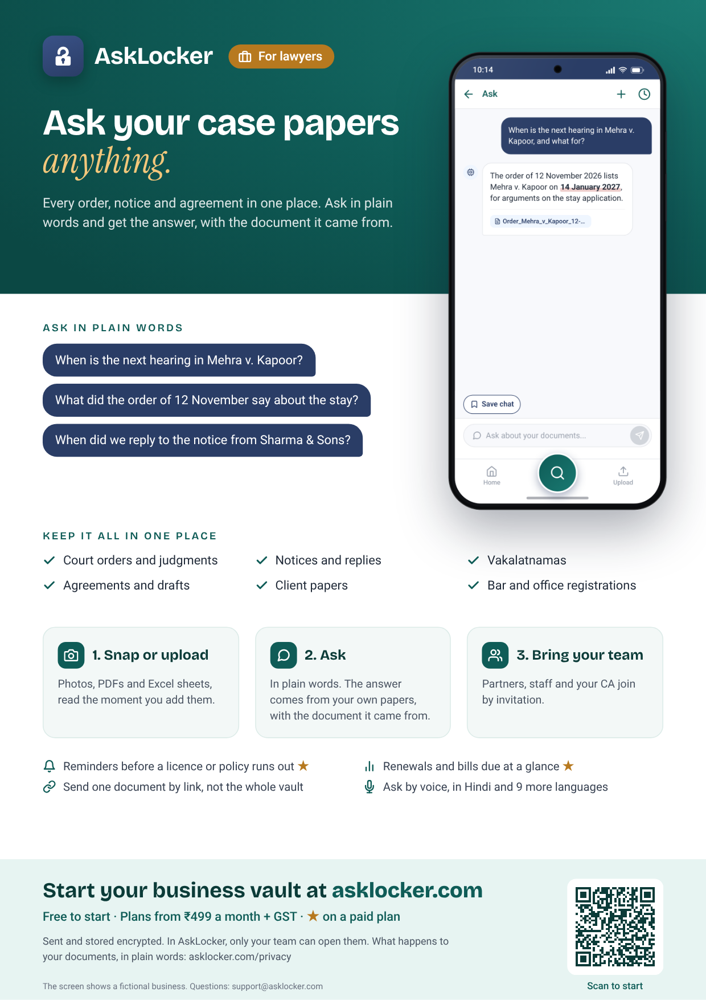
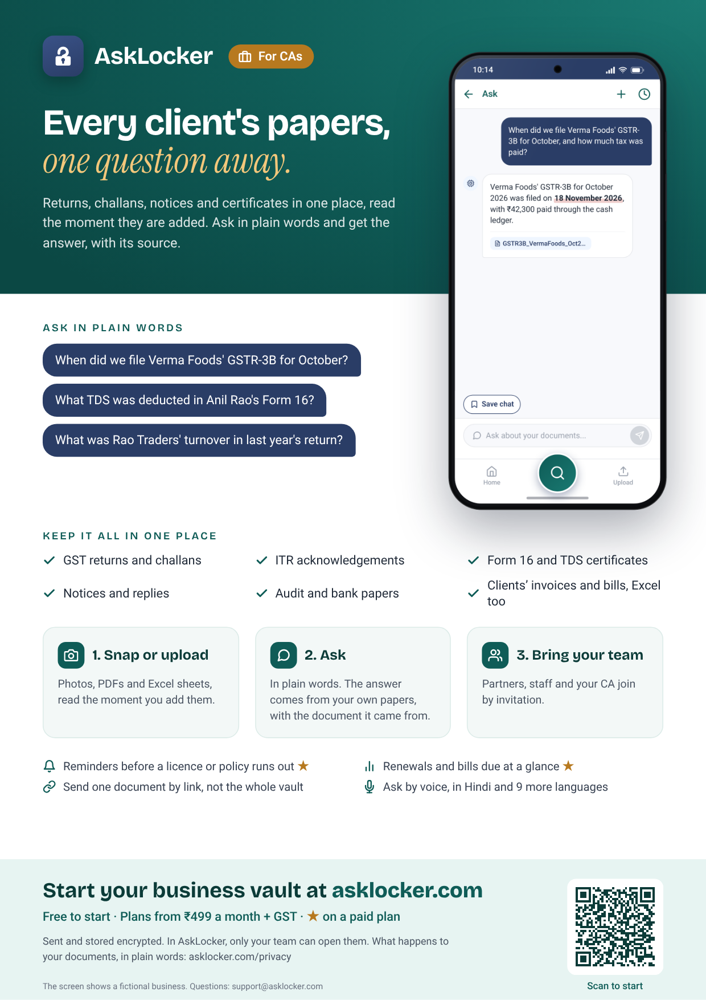
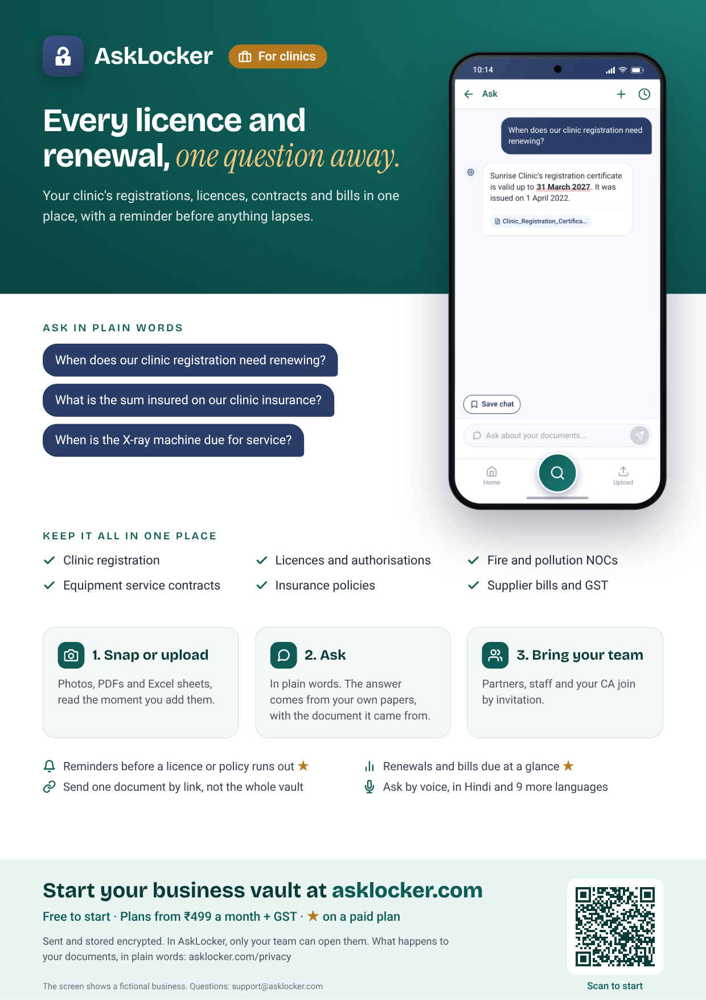
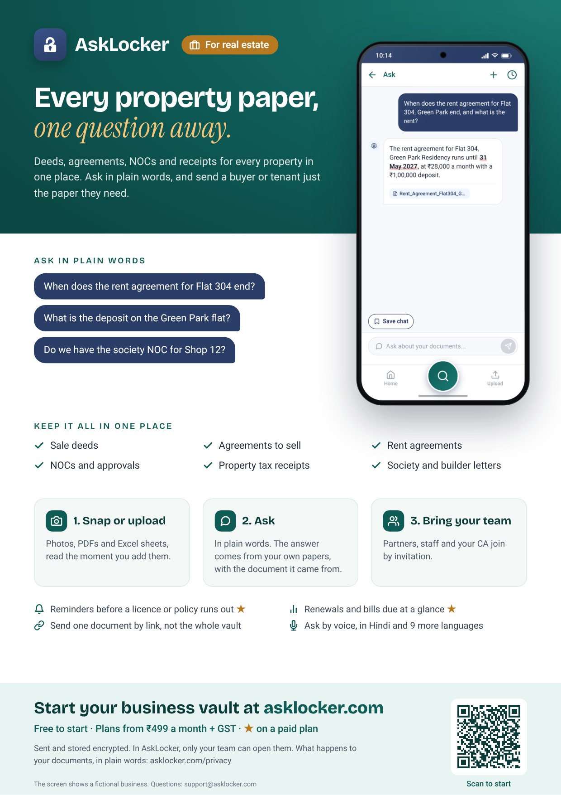
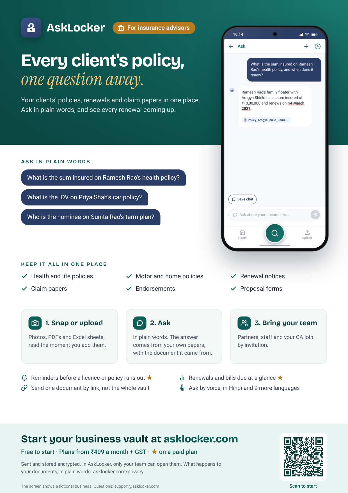
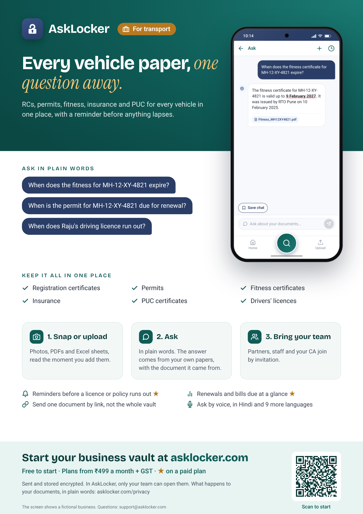

# For professions: lawyers, CAs, clinics and more

One folder per profession whose work lives on paper. Each holds a short
video, two posters and a one-page pamphlet, all showing that profession's
own question answered from its own document. **All of it can be posted
today.**

| In each folder | Use it for |
|---|---|
| `asklocker-<profession>-9x16.mp4` (about 17 s) | Reels, YouTube Shorts, WhatsApp Status, sending on WhatsApp |
| `asklocker-<profession>-9x16-sfx-only.mp4` | The same without music, to add a platform's own sound |
| `asklocker-<profession>-1080x1080.png` | Instagram and WhatsApp posts |
| `asklocker-<profession>-1920x1080.png` | LinkedIn, X, slides |
| `asklocker-<profession>-pamphlet-a4.pdf` | Printing (A4, colour): leave at a chamber, a clinic's reception, an association's office |
| `asklocker-<profession>-pamphlet.png` | Sending the pamphlet on WhatsApp or email |

Each pamphlet's QR code opens asklocker.com, marked with the profession it
came from (`utm_source=pamphlet`).

## Lawyers

[Short](./lawyers/asklocker-lawyers-9x16.mp4) · [no music](./lawyers/asklocker-lawyers-9x16-sfx-only.mp4) · posters [1:1](./lawyers/asklocker-lawyers-1080x1080.png), [16:9](./lawyers/asklocker-lawyers-1920x1080.png) · pamphlet [PDF](./lawyers/asklocker-lawyers-pamphlet-a4.pdf), [PNG](./lawyers/asklocker-lawyers-pamphlet.png)

The short asks: "When is the next hearing in Mehra v. Kapoor, and what for?"

**Caption:** The next hearing, the stay, the reply sent: ask your case papers in plain words and get the answer with the order it came from. Free to start: asklocker.com #Lawyers #Advocates #LegalPractice #LawFirm #AskLocker

**To send** (WhatsApp, with the short and the pamphlet PNG):

> Namaste {name}. I built AskLocker: a place for every order, notice and agreement, where you just ask ("When is the next hearing in Mehra v. Kapoor?") and get the answer with the document it came from. Your juniors and clerk can join by invitation. Free to start. Here is a 15-second video and a one-page sheet. Happy to set it up with you in 15 minutes.

## Chartered accountants

[Short](./chartered-accountants/asklocker-chartered-accountants-9x16.mp4) · [no music](./chartered-accountants/asklocker-chartered-accountants-9x16-sfx-only.mp4) · posters [1:1](./chartered-accountants/asklocker-chartered-accountants-1080x1080.png), [16:9](./chartered-accountants/asklocker-chartered-accountants-1920x1080.png) · pamphlet [PDF](./chartered-accountants/asklocker-chartered-accountants-pamphlet-a4.pdf), [PNG](./chartered-accountants/asklocker-chartered-accountants-pamphlet.png)

The short asks: "When did we file Verma Foods' GSTR-3B for October, and how much tax was paid?"

**Caption:** Returns, challans, Form 16s, notices: every client's papers in one place. Ask in plain words and get the answer with its source. Free to start: asklocker.com #CharteredAccountant #CA #GST #IncomeTax #TaxConsultant #AskLocker

**To send** (WhatsApp, with the short and the pamphlet PNG):

> Namaste {name}. I built AskLocker: every client's returns, challans and notices in one place, read the moment they're added. Ask "When did we file Verma Foods' GSTR-3B for October?" and get the answer with the document. Your team and articles join by invitation, and clients can invite you into their business vault too. Free to start. Here's a 15-second video and a one-page sheet.

## Clinics

[Short](./clinics/asklocker-clinics-9x16.mp4) · [no music](./clinics/asklocker-clinics-9x16-sfx-only.mp4) · posters [1:1](./clinics/asklocker-clinics-1080x1080.png), [16:9](./clinics/asklocker-clinics-1920x1080.png) · pamphlet [PDF](./clinics/asklocker-clinics-pamphlet-a4.pdf), [PNG](./clinics/asklocker-clinics-pamphlet.png)

The short asks: "When does our clinic registration need renewing?"

**Caption:** Registrations, licences, service contracts, supplier bills: your clinic's papers in one place, and a reminder before anything lapses. Free to start: asklocker.com #Clinic #Doctors #HealthcareIndia #ClinicManagement #AskLocker

**To send** (WhatsApp, with the short and the pamphlet PNG):

> Namaste Dr {name}. I built AskLocker for a clinic's own papers: registrations, licences, NOCs, service contracts and supplier bills, in one place. Ask "When does our clinic registration need renewing?" and get the answer with the certificate, and on a paid plan a reminder 90, 30 and 7 days before. Free to start. Here's a 15-second video and a one-page sheet.

## Real estate

[Short](./real-estate/asklocker-real-estate-9x16.mp4) · [no music](./real-estate/asklocker-real-estate-9x16-sfx-only.mp4) · posters [1:1](./real-estate/asklocker-real-estate-1080x1080.png), [16:9](./real-estate/asklocker-real-estate-1920x1080.png) · pamphlet [PDF](./real-estate/asklocker-real-estate-pamphlet-a4.pdf), [PNG](./real-estate/asklocker-real-estate-pamphlet.png)

The short asks: "When does the rent agreement for Flat 304, Green Park end, and what is the rent?"

**Caption:** Deeds, agreements, NOCs and receipts for every property, one question away. Send a buyer or tenant just the paper they need. Free to start: asklocker.com #RealEstate #PropertyDealer #RealEstateAgent #RentAgreement #AskLocker

**To send** (WhatsApp, with the short and the pamphlet PNG):

> Namaste {name}. I built AskLocker: every deed, agreement, NOC and receipt for every property in one place. Ask "When does the rent agreement for Flat 304 end?" and get the answer with the agreement, and send a tenant or buyer just that one paper by link. Free to start. Here is a 15-second video and a one-page sheet.

## Insurance advisors

[Short](./insurance-advisors/asklocker-insurance-advisors-9x16.mp4) · [no music](./insurance-advisors/asklocker-insurance-advisors-9x16-sfx-only.mp4) · posters [1:1](./insurance-advisors/asklocker-insurance-advisors-1080x1080.png), [16:9](./insurance-advisors/asklocker-insurance-advisors-1920x1080.png) · pamphlet [PDF](./insurance-advisors/asklocker-insurance-advisors-pamphlet-a4.pdf), [PNG](./insurance-advisors/asklocker-insurance-advisors-pamphlet.png)

The short asks: "What is the sum insured on Ramesh Rao's health policy, and when does it renew?"

**Caption:** Every client's policy, renewal and claim paper, one question away, with every renewal coming up at a glance. Free to start: asklocker.com #InsuranceAdvisor #InsuranceAgent #HealthInsurance #LifeInsurance #AskLocker

**To send** (WhatsApp, with the short and the pamphlet PNG):

> Namaste {name}. I built AskLocker: your clients' policies, renewal notices and claim papers in one place. Ask "What is the sum insured on Ramesh Rao's health policy?" and get the answer with the policy, and on a paid plan see every renewal in the next 90 days. Free to start. Here's a 15-second video and a one-page sheet.

## Transport

[Short](./transport/asklocker-transport-9x16.mp4) · [no music](./transport/asklocker-transport-9x16-sfx-only.mp4) · posters [1:1](./transport/asklocker-transport-1080x1080.png), [16:9](./transport/asklocker-transport-1920x1080.png) · pamphlet [PDF](./transport/asklocker-transport-pamphlet-a4.pdf), [PNG](./transport/asklocker-transport-pamphlet.png)

The short asks: "When does the fitness certificate for MH-12-XY-4821 expire?"

**Caption:** RC, permit, fitness, insurance, PUC: every vehicle paper in one place, with a reminder before anything lapses. Free to start: asklocker.com #Transport #FleetOwner #Logistics #Trucking #AskLocker

**To send** (WhatsApp, with the short and the pamphlet PNG):

> Namaste {name}. I built AskLocker: every RC, permit, fitness certificate, insurance and PUC for every vehicle in one place. Ask "When does the fitness for MH-12-XY-4821 expire?" and get the answer with the certificate, and on a paid plan a reminder 90, 30 and 7 days before. Free to start. Here is a 15-second video and a one-page sheet.

## How to use them

1. **One profession a week.** Send the message above, with the short and the
   pamphlet, to 10–20 people you know in that profession, one by one, never
   as a broadcast. Offer to set it up with them in 15 minutes.
2. **Post the short** on Instagram, LinkedIn and WhatsApp Status the same
   week, with its caption, and the 1:1 poster two days later.
3. **Print 20–30 pamphlets** and leave them where that profession gathers:
   a bar association's room, a CA study circle, a medical association's
   meeting, a transport union's office, a property dealers' association.
4. **Ask each one who signs up which colleague would want it**, and send
   that person the same set.

## Before sending

- **Lawyers and CAs will ask who can read their clients' papers.** Say
  what the pamphlet says: "Sent and stored encrypted. In AskLocker, only
  your team can open them", and send asklocker.com/privacy, which says the
  rest in plain words. Never say "secure", "safe", "confidential" or
  "end-to-end".
- **Clinics keep their own papers here** (registrations, licences,
  contracts, bills), never patients' medical records, and the set never
  suggests otherwise.
- **★ means a paid plan**: reminders and the renewals overview. Prices
  (from ₹499 a month + GST) change without a release: check them against
  the app's Plans page.
- **Business vaults are a pilot**: paid business plans are set up by hand.
- Every firm, person, case, vehicle and amount on screen is fictional.

## Next professions

Others whose work runs on dated papers, ready to add the same way
(`../../video/src/sectors.js`, then `./tools/sectors.sh <key>`):
restaurants and cafés (FSSAI and trade licences, fire NOC), pharmacies
(drug licences), schools and coaching centres (affiliation and building
certificates, not students' records), contractors and builders (work
orders, permits, bills), small manufacturers (factory licence, pollution
consent) and travel agents (their own registrations and bookings).

Made with `../../video/tools/sectors.sh`; `../../video/tools/publish.sh`
copies them here. See [`../../video/README.md`](../../video/README.md#for-professions).
